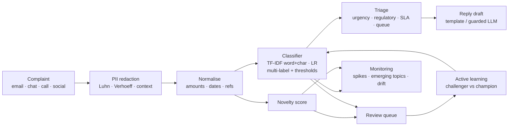

# Complaint NLP Platform

[](https://github.com/raj75114043-design/complaint-nlp-platform/actions/workflows/ci.yml)
[](https://raj-complaint-nlp-platform.streamlit.app)
[](https://gitlab.com/raj75114043/complaint-nlp-platform)


Customer-complaint intelligence for a retail bank (the fictional **Kestrel Bank**, India): every complaint arriving by
email, app chat, call transcript, web form or social media is **PII-redacted**, classified into one or more **issue
types**, scored for **urgency and regulatory risk**, routed to a **queue with an SLA**, and given a **reply draft**.
Operations sees **issue spikes**, **emerging topics the taxonomy does not cover yet**, and **data drift**; reviewers'
labels feed an **active-learning** loop with a champion/challenger model registry.

> **Live console:** https://raj-complaint-nlp-platform.streamlit.app — all complaints, names and numbers are synthetic.

---

## The problem

A bank receives thousands of complaints a week, in English, Hinglish and terse one-liners, full of typos and personal
data. Manual triage is slow, and the costly mistakes are specific:

| Failure | Why it matters | How this platform handles it |
|---|---|---|
| Card, Aadhaar or account numbers reach agents, logs or an LLM | Data-protection breach | Redaction **before** anything else; checksum-validated (Luhn, Verhoeff) and typo-tolerant context rules |
| Redacting **payment references** (UTR / UPI ref) | Investigators cannot trace the transaction | References are recognised by (fuzzy) context and **kept**; masked cards kept |
| A fraud complaint waits in a 30-day queue | Customer liability for unauthorised transactions depends on prompt action | Suspected fraud → *Fraud Response*, 7-day SLA, high urgency |
| An Ombudsman / legal threat is missed | Regulatory escalation | Escalation cues → *Executive Escalations*, regulatory-risk flag |
| One label per complaint | "Charged twice **and** a late fee" needs two teams | Multi-label classifier with per-label thresholds |
| A **new** problem is forced into an old label | It stays invisible until it is a crisis | Novelty score + "other" → review queue; NMF topic discovery on those complaints |
| The model silently degrades as language changes | Accuracy decays unnoticed | Drift monitoring (PSI, out-of-vocabulary rate, novelty rate); active learning to recover |

## Capabilities

- **PII redaction** — card (Luhn), Aadhaar (Verhoeff or explicit label), PAN, account numbers (fuzzy "acount numbr" context), phone, email, names after salutations; payment references and masked cards are deliberately preserved.
- **Normalisation** — amounts, dates, references and masked cards become placeholder tokens, so the model learns language, not numbers.
- **Classification** — TF-IDF word 1–2-grams + character 2–5-grams (robust to typos and Hinglish spelling) with logistic regression: multi-label issues (one-vs-rest, threshold per label tuned on validation data) and product.
- **New-issue detection** — novelty = 1 − max cosine similarity to training complaints; threshold at the 99th percentile of validation novelty.
- **Triage** — urgency (fraud, escalation threats, vulnerable customers), priority score, entities (amounts, payment references, dates, merchants), queue and SLA due date.
- **Reply drafts** — templates by default; optional LLM (Groq `openai/gpt-oss-120b` or Ollama) whose draft is rejected if it promises refunds or timelines, or contains digits/PII.
- **Monitoring** — weekly spike detection (robust z-score on median/MAD, with absolute and relative minimums), emerging-topic discovery (TF-IDF + NMF, English + Hinglish stop words), drift (PSI of issue mix and length, OOV rate, novelty rate).
- **Active learning** — production complaints after the training cut-off are ranked (novel / other / smallest margin); reviewer labels train a challenger, which is promoted only if it beats the champion.
- **Operations** — FastAPI (API keys, request IDs, JSON logs, Prometheus metrics), versioned model registry, Docker, CI quality gate, GitLab mirror.

## Architecture



## The data

`cnlp/data/generator.py` produces a reproducible stream of **6,000 complaints, 1 July – 30 September 2026** (CI
regenerates it and fails on any diff). It is built to contain the situations that break naive systems:

- three writing styles (English, Hinglish, terse), injected typos, multi-issue complaints;
- **held-out phrasings** — 2 of 8 phrasings per issue never appear in training and appear more often after the cut-off, so the model meets language it has not seen;
- PII inserted after typo injection (the gold labels stay exact) and decoys (UTR/UPI references, masked cards) that must **not** be redacted;
- a **refund-delay spike** in week 37 (a payment-gateway incident), and a **new issue** (e-mandate / auto-debit failures) from 14 September that is not in the taxonomy;
- escalation threats (Ombudsman, RBI, legal notice, social media) and vulnerable-customer cues.

Training uses complaints received **before 1 September 2026**; evaluation uses later complaints and a held-out test split.

## Evaluation

`python -m cnlp.eval.run --gate` runs every check below; CI fails if any gate is missed.

| Area | Metric | Result | Gate |
|---|---|---|---|
| PII | recall, every type (card, Aadhaar, PAN, account, phone, email, name) | **100%** (1,931 items) | ≥ 99% |
| PII | payment references / masked cards preserved | **100%** | ≥ 99% |
| PII | false redactions | **0%** | ≤ 1% |
| Issues | micro-F1 (test, 1,352 complaints) | **0.91** | ≥ 0.85 |
| Issues | micro-F1, phrasings seen in training | **1.00** | ≥ 0.95 |
| Issues | micro-F1, **unseen** phrasings | 0.71 | reported |
| Issues | keyword baseline micro-F1 | 0.86 | model must beat it |
| Urgency | recall / precision of high urgency | **0.92 / 1.00** | ≥ 0.90 / 0.80 |
| New issues | out-of-taxonomy complaints flagged | **98%** | ≥ 85% |
| New issues | known complaints flagged for review | 23% | ≤ 25% |
| Spikes | W37 refund-delay spike found; false issue alarms | **found; 0** | found; 0 |
| Topics | e-mandate topic discovered as *emerging* | **yes** (`mandate, auto debit, failing`) | yes |
| Drift | Jul→Aug (no change) / Jul→Sep (new issue) / noisy transcripts | **no alarm / alarm / alarm** | same |
| Active learning | unseen-phrasing F1 after 100 reviewer labels | **0.71 → 0.99** (random labels: 0.89) | gain ≥ 0.10 and beats random |

### Read these numbers honestly

- **The data is synthetic.** It was designed to be hard in specific, realistic ways, but real complaints are messier; expect lower numbers on real data and re-tune thresholds there.
- **Seen-phrasing F1 of 1.00 is not the headline** — templates seen in training are easy. The meaningful numbers are **unseen phrasing (0.71)** and how fast active learning recovers it.
- **Product accuracy is only 0.66** and is not gated: many complaints never name the product ("money debited, refund not received" could be UPI, debit card or net banking). In production the product comes from the form/channel metadata; the text model is a fallback.
- **23% of known complaints go to human review.** That is the price of catching 98% of new issues; the threshold is a business trade-off, set in `cnlp/model.py`.
- Regular expressions handle PII because they are auditable and validated with checksums; a learned NER model would be the next step for free-text names and addresses.
- SLA rules are illustrative configuration modelled on common Indian banking practice, not legal advice.

## Quick start

```bash
pip install -r requirements-dev.txt
make test eval                       # tests + full evaluation with gate
make train                           # train, register, promote if better
make console                         # Streamlit console on :8501
make api                             # REST API on :8000 (X-API-Key: dev-key)
```

```bash
curl -s localhost:8000/v1/complaints -H 'X-API-Key: dev-key' -H 'Content-Type: application/json' \
  -d '{"text":"Rs 18,000 debited on my credit card that I never did. I will go to the Banking Ombudsman.","received":"2026-10-01"}'
```

Docker: `make up` (API + console; add `--profile observability` for Prometheus). Optional LLM reply drafts: set
`GROQ_API_KEY` (free tier) or `LLM_PROVIDER=ollama` in `.env`.

| Endpoint | Purpose |
|---|---|
| `POST /v1/complaints` | redact, classify, triage, draft a reply |
| `POST /v1/complaints/batch` | up to 500 complaints |
| `POST /v1/redact` | PII redaction only |
| `GET /v1/model` | champion model card (version, cut-off, thresholds, metrics) |
| `GET /health`, `/ready`, `/metrics` | probes and Prometheus metrics |

## Repository layout

```
cnlp/
  data/generator.py   synthetic complaint stream (reproducible)
  pii.py              detection and redaction
  model.py            normalisation, features, training, registry
  triage.py           urgency, entities, queue, SLA
  monitoring.py       spikes, emerging topics, drift
  active.py           review selection, retraining with feedback
  pipeline.py         end-to-end processing and reply drafts
  api.py · cli.py · llm.py · config.py
  eval/run.py         evaluation and quality gate
streamlit_app.py      operations console
docs/                 architecture, evaluation, runbook, ADRs
```

## Design decisions

- [ADR-0001](docs/adr/0001-redact-before-everything.md) — Redact before any model, log or LLM sees the text
- [ADR-0002](docs/adr/0002-linear-models-over-transformers.md) — TF-IDF + linear models instead of a fine-tuned transformer
- [ADR-0003](docs/adr/0003-time-based-evaluation-and-novelty.md) — Time-based evaluation, held-out phrasings and novelty detection

## Limitations and roadmap

- Multilingual coverage is English + Hinglish; Devanagari and other Indian languages need a multilingual encoder (e.g. MuRIL / IndicBERT embeddings as an extra feature block).
- A transformer challenger can be added to the registry and must win under the same gate.
- Review labels are simulated from the generator's gold labels; a real deployment needs a labelling UI with inter-annotator checks.

## Licence

MIT
